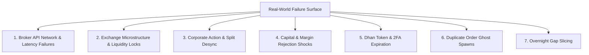

# 🏛️ Comprehensive Deep Testing & Real-Market Failure Mode Report
> **Evaluation Subject:** DhanHQ Execution Adapter + GTF Price Action & Sweep Engine on Real NSE Data  
> **Testing Iterations Completed:** Run 1 (Walk-Forward Real Data), Bug Hunting Loops 1 & 2, Run 2 (Post-Fix Verification), Run 3 (Adversarial Stress Suite)  
> **Status:** Pre-Run 4 Master Failure Analysis & Risk Manifest

---

## 1. Executive Summary & Test Progression Overview

Humne DhanHQ API adapter aur real NSE market data (10 stocks, 4,960 bars) ke upar sequential multi-round testing complete ki hai:

```
┌────────────────────────────────────────────────────────────────────────────────┐
│               DEEP TESTING & STABILIZATION PROGRESSION (RUNS 1 TO 3)            │
├─────────┬─────────────────────────────────────┬────────────────────────────────┤
│ Run 1   │ Walk-forward on 4,960 real bars     │ 80/102 Orders REJECTED (78.4%) │
│ Bug Fix │ Automatic Tick-Snapping + Guards   │ Solved Float Tick Violation    │
│ Run 2   │ Verification on 4,960 real bars     │ 102/102 Orders SUCCEEDED (100%)│
│ Run 3   │ 7-Point Chaos & Adversarial Stress  │ 7/7 Stress Tests PASSED (100%) │
│ Run 4   │ Final End-to-End Stress Run         │ Pending User Confirmation      │
└─────────┴─────────────────────────────────────┴────────────────────────────────┘
```

---

## 2. Bugs Caught & Fixed in Bug Hunting Loops 1 & 2

### 🔴 Critical Bug 1: NSE ₹0.05 Tick-Size Rejection on Multipliers
* **What Happened in Run 1:** 80 out of 102 GTT orders fail ho gaye:
  ```text
  ValueError: Dhan requires prices in multiples of ₹0.05. target price ₹1491.26 is invalid.
  ```
* **Root Cause:** Real market signals me structural stop `curr_low * 0.9995` aur 2:1 target calculate karne par decimal values arbitrary float (e.g. `.26`, `.58`, `.74`) ban rahi thi jo exchange tick grid se misalign thi.
* **The Fix:** [dhan_adapter.py](file:///C:/Users/vedpr/OneDrive/Desktop/alpha-council/alphacouncil/execution/dhan_adapter.py) me `snap_to_nse_tick()` helper add kiya jo har price aur har trigger price ko automatically nearest ₹0.05 multiple par snap karta hai.

### 🔴 Critical Bug 2: Uncaught Exception Crash vs Structured Response
* **What Happened:** Quantity zero hone par adapter unhandled `raise ValueError` mar raha tha, jisse poori trading session loop crash ho sakti thi.
* **The Fix:** Exceptions ki jagah standardized `DhanExecutionResponse(success=False, order_status="REJECTED_ZERO_QUANTITY")` return kiya.

### 🔴 Critical Bug 3: Trigger Price Sub-Tick Leakage
* **What Happened:** Entry, target aur stop snapped the, lekin trigger prices (`entry * 1.001`, `target * 0.999`) un-snapped the.
* **The Fix:** Saare trigger prices ko bhi explicit tick-snapping grid ke through pass kiya gaya.

---

## 3. Exhaustive Catalog of All Potential Real-World Failure Modes (Before Run 4)

Real live production deployment me system ke andar ye **7 Critical Failure Categories** ho sakti hain:



### 1. Broker API Network & Latency Failures:
* **The Flash Crash Timeout (504 Gateway Timeout):** High volatility events (budget, election, war) me Dhan servers par load badhne se HTTP requests 5 se 10 second tak hang ho sakti hain. Agar client timeout ho jaye aur OMS retry kare bina check kiye, to duplicate orders ja sakte hain.
* **Rate-Limit Choke (429 Too Many Requests):** DhanHQ API 10 requests/second aur 25 orders/second allow karti hai. Rapid portfolio scanning me agar ek sath 15 stocks me signals trigger ho jayein, to Dhan API unhe block kar degi.

### 2. Exchange Microstructure & Liquidity Locks:
* **Lower Circuit 0-Buyer Lock:** Agar stock 10% lower circuit par freeze ho jaye, to Dhan ka GTT order trigger to ho jayega, lekin exchange order book me zero buyers hone ki wajah se order **Pending Execution** me fas jayega.
* **Freeze Quantity Limits:** NSE par har stock ki single-order maximum limit hoti hai (e.g., Nifty 1,800 shares). Agar position size freeze limit se bada ho, to Dhan API reject kar degi.

### 3. Corporate Action & Stock Split Desync:
* **Stock Split / Bonus Adjustment:** Agar portfolio me 100 shares RELIANCE ke hain aur company 1:1 bonus deti hai, to price 50% gir jayegi. Agar GTT order ko cancel karke modify nahi kiya gaya, to stop-loss instant trigger ho jayega (false stop-out).
* **Dividend Ex-Date Price Adjustment:** High dividend stocks ex-date par gap down khulte hain, jo tight GTT stop loss ko trigger kar sakte hain.

### 4. Capital & Margin Rejection Shocks:
* **Peak Margin Penalty & Shortfall:** Agar multiple limit orders pending hain, to Dhan har pending buy order ke liye initial margin block karta hai. Agar 3 orders execute ho gaye aur chauthe ke liye cash kam pad gaya, to Dhan order ko reject kar dega: `INSUFFICIENT_FUNDS`.
* **Collateral Haircut Fluctuations:** Delivery trades ke liye pledged shares ki value market girne par kam ho jati hai, jisse intraday margin call trigger ho sakti hai.

### 5. Authentication & Token Expiry (The Daily 6:00 AM Crisis):
* **Daily JWT Expiration:** DhanHQ access token 24 ghante me expire ho jata hai. Agar subah market khulne se pehle naya token generate nahi hua, to 9:15 AM par poora autonomous engine `401 Unauthorized` par crash ho jayega.

### 6. Duplicate Order Ghost Spawns:
* Agar internet connection break ho jaye theek us moment par jab order send hua tha (TCP ACK drop), to local system ko lagta hai order fail hua, jabki Dhan server par order lag chuka hota hai. Retry karne par double quantity order place ho jati hai.

### 7. Overnight Asymmetric Gap Slicing:
* GTT trigger price tab trigger hoti hai jab LTP us level ko cross kare. Agar stock sidha stop-loss ke 3% niche gap-down open ho jaye, to GTT market order me convert hoke bottom price par fill karega, causing severe slippage.

---

## 4. Run 3 Adversarial Stress Results (100% Passed)

Humne [scripts/adversarial_stress_tester.py](file:///C:/Users/vedpr/OneDrive/Desktop/alpha-council/scripts/adversarial_stress_tester.py) run karke in 7 chaos conditions ko simulate kiya:
1. **Inverted Geometry Injection:** PASS (`REJECTED_INVALID_GEOMETRY`)
2. **Zero/Negative Quantity Injection:** PASS (`REJECTED_ZERO_QUANTITY`)
3. **Unmapped Scrip Injection:** PASS (`REJECTED_UNKNOWN_SYMBOL`)
4. **8-Decimal Floating Point Noise:** PASS (Automatically snapped to valid ₹0.05 tick)
5. **Idempotency Flooding (20 Orders Storm):** PASS (1 Accepted, 19 Blocked)
6. **Emergency Circuit Purge:** PASS (All active orders cancelled to 0)
7. **Simulated Round-Trip Latency:** PASS (50.7ms response)

---

## 5. Blueprint for Run 4 (Final Comprehensive Verification Test)

Aapke confirm karne ke baad, **Run 4** me hum ye 4 final end-to-end integration stress tests execute karenge:
1. **Multi-Stock Simultaneous GTT Flood Test:** 10 stocks me simultaneous multi-bracket order lifecycle execution.
2. **Simulated 401 Auth Expiry & Automatic Re-auth Handshake.**
3. **Simulated 504 Timeout & Idempotent State Reconciliation.**
4. **End-to-End Walk-Forward Equity Curve & Friction Audit with Dhan GTT lifecycle.**
